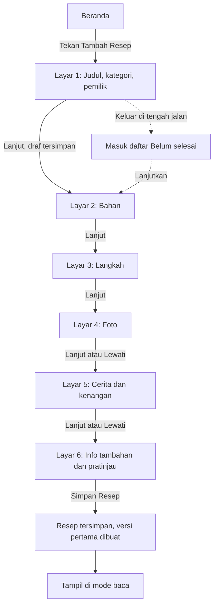
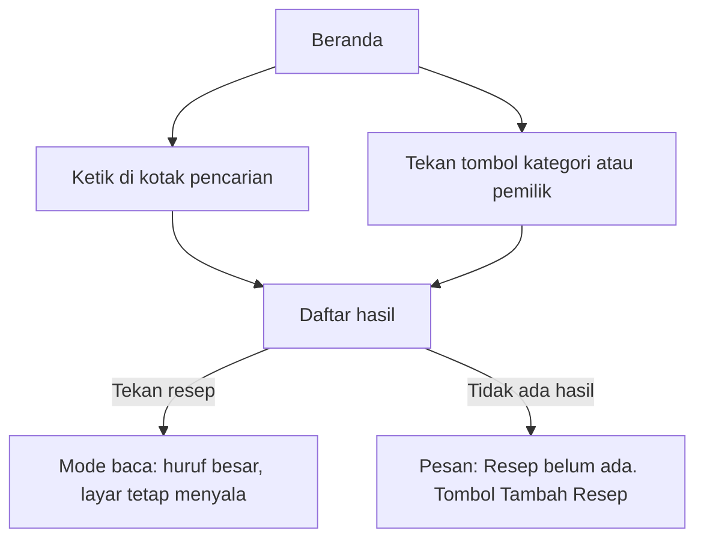
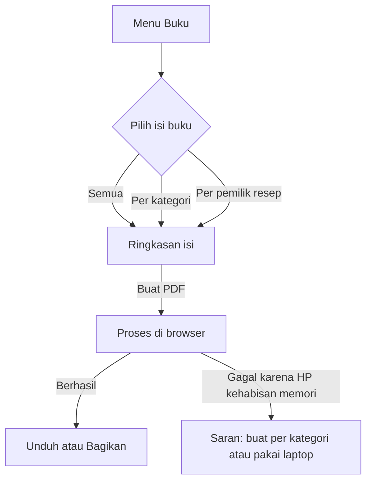

## 5. Alur Pengguna Utama

### 5.1 Tambah resep

Prinsip: hanya **judul** yang wajib diisi. Semua layar lain boleh dilewati dan dilengkapi kapan saja. [A]

| Layar | Isi | Tombol |
|---|---|---|
| 1 | Judul masakan, kategori, pemilik resep | Lanjut |
| 2 | Bahan, satu per baris | Kembali, Lanjut |
| 3 | Langkah memasak, satu per baris | Kembali, Lanjut |
| 4 | Foto masakan dan foto tulisan asli | Kembali, Lewati, Lanjut |
| 5 | Cerita asal resep dan kenangan atau pesan uti | Kembali, Lewati, Lanjut |
| 6 | Info tambahan (porsi, waktu, tingkat kesulitan) dan status kelengkapan, lalu pratinjau | Kembali, Simpan Resep |

Setiap tekan "Lanjut" data tersimpan sebagai draf di server.

### 5.2 Cari resep

1. Beranda menampilkan kotak pencarian besar di paling atas.
2. Pengguna mengetik nama masakan atau bahan. Hasil muncul saat mengetik.
3. Di bawah kotak pencarian ada tombol kategori dan pemilik resep untuk menyaring.
4. Pengguna menekan satu resep, lalu masuk mode baca.

### 5.3 Export ke buku PDF

1. Pengguna membuka menu **Buku**.
2. Memilih isi buku: Semua resep, Per kategori, atau Per pemilik resep.
3. Layar ringkasan menampilkan jumlah resep yang akan masuk dan pilihan "Sertakan foto tulisan asli".
4. Menekan **Buat PDF**. Muncul indikator proses.
5. Setelah selesai, tersedia tombol **Unduh** dan **Bagikan** (misalnya ke WhatsApp) [A].

