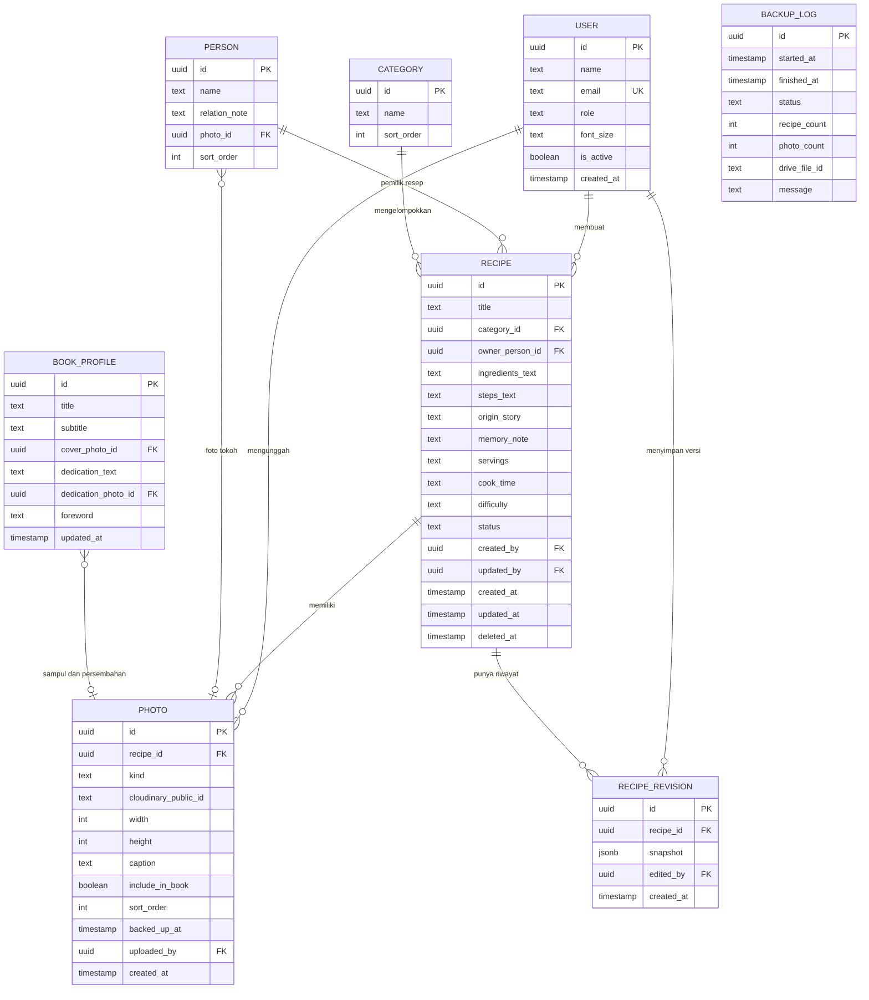

## 7. Rancangan Data

### 7.1 Daftar entitas dan atribut

Catatan: library autentikasi (lihat bagian 9) membuat tabel akun dan sesinya sendiri. Entitas USER di bawah menggambarkan tabel pengguna tersebut beserta kolom tambahan yang kita perlukan.

**USER** (akun pengguna aplikasi)

| Atribut | Tipe | Keterangan |
|---|---|---|
| id | uuid | Kunci utama |
| name | text | Nama tampilan, misalnya "Ibu" |
| email | text | Unik, untuk login |
| role | text | admin atau anggota |
| font_size | text | normal, besar, sangat_besar |
| is_active | boolean | Akun nonaktif tidak bisa login |
| created_at | timestamp | Waktu dibuat |

**PERSON** (pemilik resep, tidak harus punya akun)

| Atribut | Tipe | Keterangan |
|---|---|---|
| id | uuid | Kunci utama |
| name | text | Misalnya "Uti", "Ibu", "Budhe" |
| relation_note | text | Keterangan hubungan keluarga, opsional |
| photo_id | uuid | Foto tokoh untuk halaman buku, opsional |
| sort_order | int | Urutan tampil |

**CATEGORY**

| Atribut | Tipe | Keterangan |
|---|---|---|
| id | uuid | Kunci utama |
| name | text | Misalnya Lauk, Sayur, Kue, Sambal, Minuman |
| sort_order | int | Urutan di aplikasi dan di buku |

**RECIPE**

| Atribut | Tipe | Keterangan |
|---|---|---|
| id | uuid | Kunci utama |
| title | text | Wajib |
| category_id | uuid | Kategori, boleh kosong saat draf |
| owner_person_id | uuid | Pemilik resep, boleh kosong saat draf |
| ingredients_text | text | Satu bahan per baris |
| steps_text | text | Satu langkah per baris, dinomori otomatis saat tampil |
| origin_story | text | Cerita asal resep |
| memory_note | text | Kenangan atau pesan uti |
| servings | text | Opsional, teks bebas agar bisa diisi "4 sampai 5 orang" |
| cook_time | text | Opsional, teks bebas |
| difficulty | text | Opsional: mudah, sedang, sulit |
| status | text | draf, perlu_dicek, lengkap |
| created_by | uuid | Pengguna pembuat |
| updated_by | uuid | Pengguna terakhir yang mengubah |
| created_at | timestamp | |
| updated_at | timestamp | |
| deleted_at | timestamp | Terisi jika di tempat sampah |

**PHOTO**

| Atribut | Tipe | Keterangan |
|---|---|---|
| id | uuid | Kunci utama |
| recipe_id | uuid | Boleh kosong untuk foto sampul, persembahan, atau tokoh |
| kind | text | masakan, tulisan_asli, sampul, persembahan, tokoh |
| cloudinary_public_id | text | ID foto di Cloudinary |
| width | int | Lebar piksel |
| height | int | Tinggi piksel |
| caption | text | Keterangan foto, opsional |
| include_in_book | boolean | Ikut dicetak di buku atau tidak |
| sort_order | int | Urutan foto dalam resep |
| backed_up_at | timestamp | Terisi setelah foto tercadang ke Google Drive |
| uploaded_by | uuid | Pengguna pengunggah |
| created_at | timestamp | |

**RECIPE_REVISION** (riwayat perubahan)

| Atribut | Tipe | Keterangan |
|---|---|---|
| id | uuid | Kunci utama |
| recipe_id | uuid | Resep yang diubah |
| snapshot | jsonb | Salinan lengkap isi resep pada versi itu |
| edited_by | uuid | Pengguna yang menyimpan |
| created_at | timestamp | Waktu versi dibuat |

**BOOK_PROFILE** (pengaturan buku, satu baris per buku)

| Atribut | Tipe | Keterangan |
|---|---|---|
| id | uuid | Kunci utama |
| title | text | Judul buku |
| subtitle | text | Subjudul, opsional |
| cover_photo_id | uuid | Foto sampul |
| dedication_text | text | Teks persembahan untuk uti |
| dedication_photo_id | uuid | Foto uti untuk halaman persembahan |
| foreword | text | Kata pengantar |
| updated_at | timestamp | |

**BACKUP_LOG**

| Atribut | Tipe | Keterangan |
|---|---|---|
| id | uuid | Kunci utama |
| started_at | timestamp | |
| finished_at | timestamp | |
| status | text | berhasil, gagal |
| recipe_count | int | Jumlah resep dalam file backup |
| photo_count | int | Jumlah foto baru yang tercadang |
| drive_file_id | text | ID file backup di Google Drive |
| message | text | Pesan error jika gagal |

### 7.2 Diagram relasi entitas

### 7.3 Catatan rancangan [A]

1. **PERSON dipisah dari USER** karena pemilik resep (uti) tidak punya akun, sedangkan penulis resep (ibu) punya akun. Satu orang bisa muncul di keduanya.
2. **Bahan dan langkah disimpan sebagai teks**, bukan tabel terpisah, sesuai keputusan teks bebas. Pemisahan per baris dilakukan saat tampil dan saat membuat PDF.
3. **Riwayat disimpan sebagai snapshot JSON**, sehingga mengembalikan versi cukup menyalin isi snapshot ke resep, lalu membuat snapshot baru. Riwayat tidak pernah dihapus.
4. **Penghapusan lunak** memakai `deleted_at`. Semua kueri daftar resep menyaring `deleted_at` yang kosong.
5. **Estimasi ukuran data**: teks 100 resep beserta puluhan versi riwayat diperkirakan hanya puluhan megabyte, jauh di bawah kuota Neon gratis 0,5 GB. Ini perkiraan kasar, bukan hasil ukur.

